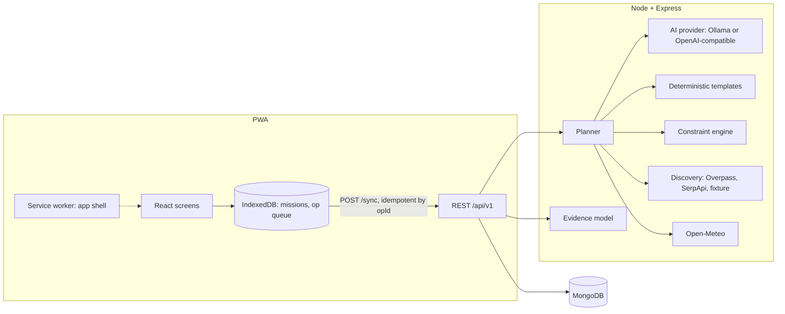

# ShadeLoop

**Go outside. Discover more. Make every walk count.**

ShadeLoop is an open-source outdoor field companion. It proposes short outdoor missions (5–120 min) that a deterministic rule engine has checked. You run them in an offline-capable Field Mode and record what you actually find. Those reports feed a shared, explainable evidence model that makes the next recommendations more honest.

## The problem

Map apps tell you a park exists. They can't tell you whether the bench is still there, whether the shade is real at 2 pm, or whether it's quiet. AI assistants will happily invent those facts. ShadeLoop treats every such condition as **unknown until people report it**, and shows where each claim comes from.

## Field truth loop

1. **Plan:** a request is parsed into constraints (AI or keyword fallback). Candidates come from AI or templates, then pass the constraint engine: time, walking limit, safety text, real locations only, and required conditions checked against evidence.
2. **Go:** Field Mode shows one step at a time with big quick-observation buttons (e.g. `shade_quality = none`). Everything is queued in IndexedDB and works offline.
3. **Report:** completing a mission produces planned-vs-observed comparisons (`observed_lower_than_expected`, …) and a deterministic template summary built from the recorded facts (labelled; no AI on the completion path).
4. **Learn:** each location report updates a categorical evidence summary per (location, attribute): `unknown | low | moderate | conflicting | stale`. Future plans show these and refuse places whose *required* conditions are contradicted.

## Architecture



The AI never writes to the database, decides safety, invents places or weather, or overrides the engine. See [docs/AI_POLICY.md](docs/AI_POLICY.md).

## Stack

npm workspaces: `shared` (Zod schemas), `server` (Node ≥ 23.6 running TypeScript natively, Express 5, Zod, MongoDB driver, pino, helmet, express-rate-limit), `web` (React 19, Vite 8, vite-plugin-pwa, idb). Tests: Vitest, Supertest, mongodb-memory-server, fake-indexeddb.

## Setup

Requires Node ≥ 23.6 (tested on 26.10).

```bash
npm install
cp .env.example .env          # defaults: in-memory MongoDB, AI off, live OSM discovery
npm run dev                   # API on :8080, web on :5173 (proxies /api)
```

The first run with `MONGODB_URI=memory` downloads a MongoDB binary (about 100 MB) through mongodb-memory-server.

**Gemma via Ollama (optional):** `ollama pull gemma3:4b`, run `ollama serve`, then set `AI_PROVIDER=ollama` in `.env`. Local planning with gemma3:4b took about 20–30 s per request on the development Mac.

**Production-style run:** `npm run build && MONGODB_URI=<atlas-uri> NODE_ENV=production npm start` serves the API and the built PWA on `:8080`.

## Environment variables

| Variable | Default | Purpose |
|---|---|---|
| `MONGODB_URI` | required | Atlas/Mongo URI, or `memory` (dev/test only; rejected in production) |
| `MONGODB_DB` | `shadeloop` | Database name |
| `PORT` / `NODE_ENV` / `LOG_LEVEL` | `8080` / `development` / `info` | |
| `TRUST_PROXY` | `0` | Proxy hops (Render: `1`) for rate-limit IPs |
| `RATE_LIMIT_PER_MIN` | `120` | Per-IP budget. Planning, discovery and note parsing get 1/8 of it, session creation 1/6 |
| `AI_PROVIDER` | `none` | `none`, `ollama` or `openai` |
| `OLLAMA_URL` / `OLLAMA_MODEL` | `http://localhost:11434` / `gemma3:4b` | |
| `OPENAI_BASE_URL` / `OPENAI_API_KEY` / `OPENAI_MODEL` | none | Any OpenAI-compatible chat-completions API |
| `AI_TIMEOUT_MS` / `AI_MAX_RETRIES` | `60000` / `1` | Per attempt, and extra attempts after the first |
| `DISCOVERY_MODE` | `live` | `live` (Overpass, plus SerpApi if a key is set) or `fixture` (labelled fake places) |
| `SERPAPI_KEY` | none | Enables SerpApi Google Maps results |
| `OVERPASS_URL` / `OPEN_METEO_URL` / `HTTP_TIMEOUT_MS` | public endpoints / `20000` | |

## Testing

```bash
npm run lint && npm run typecheck && npm test && npm run build
```

There are 84 server tests (unit and integration, including an end-to-end field-truth-loop test) and 21 web queue tests. External services are mocked in tests. See [docs/TEST_PLAN.md](docs/TEST_PLAN.md).

## Deployment

- **Render:** `render.yaml` defines one web service that serves the API and PWA on Node 24. Set `MONGODB_URI` (Atlas) in the dashboard. `TRUST_PROXY=1` assumes exactly one proxy hop in front of the app (rate limits use the client IP from `X-Forwarded-For`); this was not verified on Render.
- **Docker:** `docker build -t shadeloop . && docker run -p 8080:8080 -e NODE_ENV=production -e MONGODB_URI=... shadeloop`. Two stages: the build stage installs everything and builds the PWA; the runtime stage (`node:24-alpine`, user `node`) installs only the server's production dependencies (`npm ci --omit=dev --workspace=server`) and copies `server/src`, `shared/src` and `web/dist`. No `.env` file is copied (`.dockerignore`). A `HEALTHCHECK` calls `/api/v1/health` with Node's `fetch` (no curl in the image). Built from a clean checkout and run against a `mongo:8` container on 2026-10-11 (271 MB). Not yet deployed to Render or Atlas.
- **CI:** `.github/workflows/ci.yml` on Node 24 (the production target): lint, typecheck, tests, PWA build, `npm audit --omit=dev --audit-level=high`, and a Docker image build (never pushed). No credentials or paid APIs: tests mock every external call and use mongodb-memory-server, whose binary is cached between runs.

### Operations
- **Startup:** invalid env exits 1 listing the field names (never values). Production refuses `MONGODB_URI=memory`. If MongoDB is unreachable or index creation fails, the process logs `startup failed: …` (hosts only) and exits 1. Optional integrations (AI, SerpApi) are never required.
- **Health:** `GET /api/v1/health` is liveness only (no DB or network call). `GET /api/v1/health/dependencies` pings MongoDB and reuses one AI probe for 60 s; place and weather statuses come from the last real call, so the public endpoint can't be used to drive provider traffic.
- **Shutdown:** SIGTERM/SIGINT stop accepting connections, close the HTTP server and the Mongo client, log `shutdown complete` and exit 0; anything still open after 10 s is cut off with exit 1.
- **Indexes:** created at every start, never dropped automatically. See docs/ARCHITECTURE.md → Indexes for the one obsolete index to drop by hand on databases created before 2026-10-11.
- **Headers:** helmet defaults; the CSP's `upgrade-insecure-requests` is sent only in production, so a dev or LAN build over plain HTTP (e.g. `http://192.168.x.x:8080` on a phone) still loads its scripts.
- **Logs:** pino JSON. Request logs carry only id, method, URL and status; tokens, coordinates, note/prompt/feedback text and API keys are redacted.

## Demo

1. `npm run dev`, open http://localhost:5173.
2. Settings → "Use my approximate location" (rounded to about 1 km), then Save.
3. Discover → "a quiet 20 minute break with some shade" → Suggest missions. Each card shows whether AI or a template produced it, the evidence status of each condition, and what is unknown.
4. Open a mission → Start → record a few quick observations. Go offline (DevTools) and keep recording. The badge shows "Offline · N waiting to sync". Reload: the mission still opens. Go back online and the queue syncs.
5. End mission → see planned vs actual and the report. Run the same place with other sessions (e.g. private windows) to watch the evidence move from `low` to `moderate`, or to `conflicting`.

For a demo without network discovery, set `DISCOVERY_MODE=fixture`. Places are then labelled "sample fixture, not real" everywhere.

## Limitations (honest)

- No real auth: anonymous bearer-token sessions only. Clearing site data loses access to your missions.
- No routing. Distances are straight-line from a coarse (about 1 km) location, and travel time is an estimate.
- Evidence needs several independent sessions to reach `moderate`. Sessions are not identities, and presence at a place is not checked, so one person with a few sessions can skew it without being there. A session counts once per place and attribute, and a mission accepts at most 40 observations (10 per attribute), so a single session can't flood other reports away. There is no minimum session age or mission duration for a report to count: both would be easy to wait out.
- Nothing is verified. No verified accessibility source is integrated (OSM `wheelchair` tags are not used), so step-free access, seating and path condition always show as **unverified** with a "check access yourself" notice, even when reports agree. OpenStreetMap place data is labelled "map data".
- Small local models (gemma3:4b) often overshoot time budgets. The engine shortens or rejects them, then falls back to templates. Durations live only in step minutes: AI text that states a duration ("10 minutes", "half an hour") is rejected, so it can't contradict shortened steps. The detector is a phrase list, so unusual wordings can slip through, and harmless ones ("take a minute") cause a template fallback. The "why it fits" line written by AI is not checked for durations.
- The public Overpass API is sometimes slow or returns 504. Planning then proceeds without named places and says so.
- English only. Voice uses browser APIs only (Web Speech), where supported.
- Offline changes the server refuses (for example observations for a mission that expired or was cancelled elsewhere) can't be applied. They stay on the device, held per mission, until you download or discard them. There is no merge.
- Device clocks are corrected per sync request from the time the device says it sent it, so a wrong clock no longer loses data. Corrected times can be late by the request latency, and changing the device clock between recording and syncing shifts those events (they are clamped between the previous event and now). Clients without `sentAt` keep the old 5-minute rule.
- Durations: you can enter 0–240 minutes; a duration measured from timestamps that is negative or over 240 minutes (e.g. a mission left running for days) is shown as unknown and left out of your totals. Entered minutes are labelled as your estimate and the report shows the measured time next to them, but they aren't corrected or flagged when the two differ; totals use your estimate and say how many estimates they include.
- A sync op the server can't accept (e.g. a value an older app version allowed) is refused on its own and kept on the device as a conflict; the rest of the batch is applied. Only a malformed batch (missing opId, bad timestamps) is refused as a whole.
- Anonymous owners never expire, and the place/weather cache and 429 back-off are per process (see docs/ARCHITECTURE.md).
- The repo lives at `~/ShadeLoop` (see docs/DECISIONS.md, item 0).

## License

MIT
