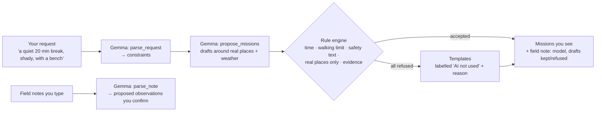
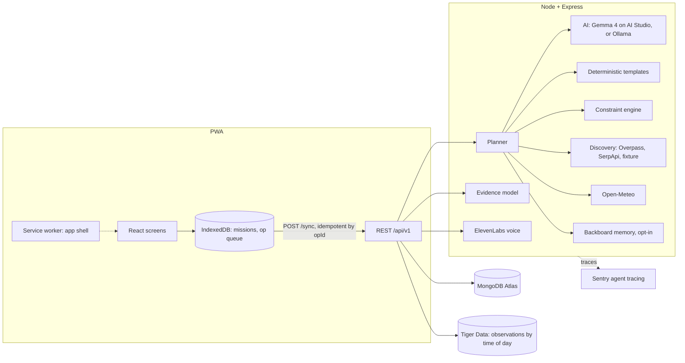

# ShadeLoop

**Go outside. Discover more. Make every walk count.**

Live: https://shadeloop.onrender.com (Render free plan: the first visit after it has been idle can take about a minute to wake up).

ShadeLoop is an open-source outdoor field companion. It proposes short outdoor missions (5–120 min) that a deterministic rule engine has checked. You run them in an offline-capable Field Mode and record what you actually find. Those reports feed a shared, explainable evidence model that makes the next recommendations more honest.

## Hacktoberfest 2026 · Touch Grass: sponsor tracks at a glance

Built for the DEV [Hacktoberfest Open-Source AI Challenge, Week 1: Touch Grass](https://dev.to/challenges/hacktoberfest-week1-2026-10-05) (Oct 5–11, 2026). Every row is real code you can open, and each one degrades to a labelled fallback when its key is missing. Live status for every integration is on the site under **Settings → Integrations**, read from `GET /api/v1/health/dependencies` (a key alone shows "configured"; only a real successful call shows "verified").

| Track | What it does in ShadeLoop | Where in the code |
|---|---|---|
| **Gemma** (featured) | Gemma 4 (`gemma-4-26b-a4b-it`, AI Studio) in production, `gemma3:4b` through Ollama locally: parses requests and field notes, drafts missions. A deterministic engine accepts, shortens or rejects every draft | `server/src/ai.ts`, `server/src/missions.ts`, `docs/AI_POLICY.md` |
| **Render** (featured) | Hosts the Docker image (API + PWA) at https://shadeloop.onrender.com from `render.yaml` | `render.yaml`, `Dockerfile` |
| **Sentry Agent Tracing** | Each plan is an `invoke_agent plan_missions` trace with `execute_tool` spans (weather, places, memory) and `chat <model>` spans carrying token usage, attempts and fallbacks; voice (`speak_step`, `speak_report`) and similarity search (`similar_places`) are traced as tools too | `server/src/instrument.ts`, `server/src/integrations.ts` |
| **ElevenLabs** | Reads Field Mode steps aloud (`eleven_flash_v2_5`) so your eyes stay on the trail, and reads the completion report back (“Listen to report”); browser voice offline, and the UI says which voice spoke | `speak` in `server/src/providers.ts`, `GET /missions/:id/steps/:n/speech`, `GET /reports/:id/speech`, `web/src/Field.tsx` |
| **Tiger Data** | TimescaleDB hypertable of place observations + 15-minute continuous aggregate behind "Reports here by time of day", and **pgvector**: each place gets a 19-dimension field-report fingerprint (share of reports per attribute value), and `<=>` cosine search powers “Places with similar field reports” on a mission | `server/src/tiger.ts`, `GET /locations/:id/similar` |
| **Backboard** | Opt-in memory of your own past requests ("no stairs"), recalled before planning, deleted with your data | `recall`/`remember` in `server/src/providers.ts` |
| **MongoDB Atlas** | Source of truth for missions, observations, reports and the shared evidence model | `server/src/db.ts`, `server/src/missions.ts` |
| **Process log** | Every plan returns an additive `planning.log` (step, ok, start offset, duration, detail) recorded around the same tool calls Sentry traces: memory recall, weather, places per source, Gemma drafting, each rule-engine accept or refusal, template fallback, memory save. Discover shows it as a field log | `logged` in `server/src/missions.ts`, `ProcessLog` in `web/src/App.tsx` |
| **Visible in the app** | Every plan shows a “what ran” strip: which model read the request and drafted, that the rule engine checked it, which place sources returned how many results, weather, and Backboard recall. Only things that actually ran are listed | `FieldKit` in `web/src/App.tsx` |
| **GitHub Copilot / Actions** | CI on every push (lint, typecheck, 124 server + 38 web tests, PWA build, audit, Docker build); Copilot issue #1 fixed in commit `89b8ead` | `.github/workflows/ci.yml` |
| **Entire** | Agent session behind a real fix: https://entire.io/gh/CodewithJha/shadeloop/commit/89b8eada487181a88134341db161312060d1bce4 | |
| **SerpApi** | Google Maps place results next to OpenStreetMap; verified live 2026-10-12 (20 places) | `server/src/providers.ts` |

### How Gemma fits in



Gemma proposes; plain code decides. Every plan in the app shows a field note naming the Gemma model, how many drafts the rule engine accepted, and the exact reason for each one it refused.

**Live run on https://shadeloop.onrender.com (2026-10-12, about 10:30 IST, one test session, deleted afterwards):**
- **Gemma:** `gemma-4-26b-a4b-it` parsed the request (`method: ai`) and drafted the mission, which the engine accepted (about 26 s, 2 model calls). On a second request the engine refused Gemma's draft ("walking 23 min exceeds your limit of 20 min") and fell back to templates, which is shown in the UI.
- **SerpApi** returned 20 places. **Backboard** saved the first request and recalled 1 memory on the second plan.
- **ElevenLabs** returned step audio (20 KB in 1.5 s) and report audio (63 KB).
- **Tiger Data:** the time-of-day aggregate returned rows, and **pgvector** "similar places" matched the two test places to each other (both had identical test reports, so similarity 1.0).
- **MongoDB** synced and deleted everything with `DELETE /me` (4 missions, 6 observations, 2 reports, 6 Tiger rows, the Backboard memory).
- **Failed that run:** OpenStreetMap Overpass returned `fetch failed` and Open-Meteo returned `429` from Render's shared IP. Both are shown honestly as failed in the app, and planning continued.

Not used on purpose: Mastra, Temporal, TabPFN, Tinker, Arduino, DigitalOcean (no real job for them in this scope).

**Timeline note (challenge rules):** the repository was started on 2026-10-11 at 12:31 IST (2026-10-10 23:01 PDT) and submitted before 11:59 PM PDT on 2026-10-11 (12:29 PM IST on 2026-10-12). Any commit dated after that deadline is listed here; commits on 2026-10-12 IST up to the submission are all before 12:29 IST (= 11:59 PM PDT, Oct 11).

## The problem

Map apps tell you a park exists. They can't tell you whether the bench is still there, whether the shade is real at 2 pm, or whether it's quiet. AI assistants will happily invent those facts. ShadeLoop treats every such condition as **unknown until people report it**, and shows where each claim comes from.

## Field truth loop

1. **Plan:** a request is parsed into constraints (AI or keyword fallback). Candidates come from AI or templates, then pass the constraint engine: time, walking limit, safety text, real locations only, and required conditions checked against evidence.
2. **Go:** Field Mode shows one step at a time with big quick-observation buttons (e.g. `shade_quality = none`). Everything is queued in IndexedDB and works offline.
3. **Report:** completing a mission produces planned-vs-observed comparisons (`observed_lower_than_expected`, …) and a deterministic template summary built from the recorded facts (labelled; no AI on the completion path).
4. **Learn:** each location report updates a categorical evidence summary per (location, attribute): `unknown | low | moderate | conflicting | stale`. Future plans show these and refuse places whose *required* conditions are contradicted.

## Architecture



Every integration except MongoDB is optional and degrades to a labelled fallback. What each does, its env vars, failure mode and privacy behaviour: [docs/INTEGRATIONS.md](docs/INTEGRATIONS.md).

| Integration | Used for |
|---|---|
| Gemma 4 (`gemma-4-26b-a4b-it`) via Google AI Studio | Parsing requests and notes, proposing missions. The engine checks every proposal |
| MongoDB Atlas | Source of truth for missions, observations, reports and evidence |
| Sentry | Agent tracing: `invoke_agent`, `chat` (with token usage) and `execute_tool` spans for weather, discovery and memory |
| ElevenLabs | Reads mission steps aloud (`eleven_flash_v2_5`), cached; browser voice offline |
| Tiger Data (TimescaleDB) | Hypertable of place observations and a 15-minute continuous aggregate behind "Reports here by time of day" |
| Backboard | Opt-in memory of your own past requests, used when planning |
| OpenStreetMap Overpass, SerpApi, Open-Meteo | Places and weather (SerpApi is wired but not verified live) |
| Render | Hosts the Docker image at https://shadeloop.onrender.com (free plan, so the first request after idle is slow) |

The AI never writes to the database, decides safety, invents places or weather, or overrides the engine. See [docs/AI_POLICY.md](docs/AI_POLICY.md).

## Stack

npm workspaces: `shared` (Zod schemas), `server` (Node ≥ 23.6 running TypeScript natively, Express 5, Zod, MongoDB driver, pg, @sentry/node, pino, helmet, express-rate-limit), `web` (React 19, Vite 8, vite-plugin-pwa, idb). Tests: Vitest, Supertest, mongodb-memory-server, fake-indexeddb.

## Setup

Requires Node ≥ 23.6 (tested on 26.10).

```bash
npm install
cp .env.example .env          # defaults: in-memory MongoDB, AI off, live OSM discovery
npm run dev                   # API on :8080, web on :5173 (proxies /api)
```

The first run with `MONGODB_URI=memory` downloads a MongoDB binary (about 100 MB) through mongodb-memory-server. The in-memory database is empty on every server start: missions, observations and sessions are lost on restart (the browser then gets a new session automatically, and missions cached on the device show as "no longer exists on the server"). Without a `.env`, pass the variables inline, e.g. `MONGODB_URI=memory DISCOVERY_MODE=fixture npm run dev`.

No variable needs a key or account: only `MONGODB_URI` is required. AI, SerpApi, Sentry, ElevenLabs, Tiger Data and Backboard are optional and off without their variable; Overpass and Open-Meteo are keyless public services.

**Gemma 4 via Google AI Studio (optional, used in production):** `AI_PROVIDER=openai`, `OPENAI_BASE_URL=https://generativelanguage.googleapis.com/v1beta/openai`, `OPENAI_MODEL=gemma-4-26b-a4b-it` and your AI Studio key in `OPENAI_API_KEY`.

**Local MongoDB instead of memory (data survives restarts):** `docker run -d --name shadeloop-mongo -p 27017:27017 mongo:8`, then `MONGODB_URI=mongodb://localhost:27017`.

**Gemma via Ollama (optional):** `ollama pull gemma3:4b`, run `ollama serve`, then set `AI_PROVIDER=ollama` in `.env`. Local planning with gemma3:4b took about 20–30 s per request on the development Mac.

**Production build locally:** `npm run build && MONGODB_URI=memory npm start` serves the API and the built PWA (with its service worker) on `:8080`. This is the way to try offline mode and app updates; `npm run dev` doesn't register a service worker.

**Production-style run:** `npm run build && MONGODB_URI=<atlas-uri> NODE_ENV=production npm start`.

**Check it's up:** `curl localhost:8080/api/v1/health` (liveness) and `curl localhost:8080/api/v1/health/dependencies` (MongoDB ping plus the status of each integration).

**Troubleshooting**
- `Invalid env MONGODB_URI: …` and exit 1: set `MONGODB_URI` (`memory` for dev). Production refuses `memory`.
- `EADDRINUSE`: something already uses 8080 (API) or 5173 (Vite). Set `PORT` for the API; the Vite proxy in `web/vite.config.ts` expects the API on 8080.
- AI shows `DEGRADED`: Ollama isn't running or the model isn't pulled (`ollama list`), or the AI Studio key or model name is wrong. Planning still works with templates and says so.
- No named places: live Overpass is often slow or returns 504; use `DISCOVERY_MODE=fixture` for demos (places are labelled as samples).
- After pulling new code, an open PWA shows "A new version of ShadeLoop is ready" with a Reload button. It never reloads by itself, and the offer waits while Field Mode, the completion form or unsaved input is on screen.

## Environment variables

| Variable | Default | Purpose |
|---|---|---|
| `MONGODB_URI` | required | Atlas/Mongo URI, or `memory` (dev/test only; rejected in production) |
| `MONGODB_DB` | `shadeloop` | Database name |
| `PORT` / `NODE_ENV` / `LOG_LEVEL` | `8080` / `development` / `info` | |
| `TRUST_PROXY` | `0` | Proxy hops (Render: `1`) for rate-limit IPs |
| `RATE_LIMIT_PER_MIN` | `120` | Per-IP budget. Planning, discovery and note parsing get 1/8 of it, session creation 1/6 |
| `AI_PROVIDER` | `none` | `none`, `ollama` or `openai` |
| `OLLAMA_URL` / `OLLAMA_MODEL` | `http://localhost:11434` / `gemma3:4b` | |
| `OPENAI_BASE_URL` / `OPENAI_API_KEY` / `OPENAI_MODEL` | none | Any OpenAI-compatible chat-completions API (production: Gemma 4 on Google AI Studio) |
| `AI_TIMEOUT_MS` / `AI_MAX_RETRIES` | `60000` / `1` | Per attempt, and extra attempts after the first |
| `DISCOVERY_MODE` | `live` | `live` (Overpass, plus SerpApi if a key is set) or `fixture` (labelled fake places) |
| `SERPAPI_KEY` | none | Enables SerpApi Google Maps results |
| `OVERPASS_URL` / `OPEN_METEO_URL` / `HTTP_TIMEOUT_MS` | public endpoints / `20000` | |
| `OVERPASS_FALLBACK_URLS` | kumi.systems and private.coffee mirrors | Comma-separated Overpass mirrors tried in order (10 s each) when the main one fails; `none` disables |
| `MET_NORWAY_URL` | MET Norway Locationforecast 2.0 compact | Free, keyless weather fallback used only when Open-Meteo fails or rate-limits |
| `SENTRY_DSN` | none | Enables Sentry agent tracing and error reports |
| `ELEVENLABS_API_KEY` / `ELEVENLABS_VOICE_ID` | none / a stock voice | Enables the ElevenLabs step voice |
| `TIGER_DATABASE_URL` | none | Tiger Data `postgres://` URL; enables the time-of-day mirror |
| `BACKBOARD_API_KEY` | none | Enables opt-in request memory |

## Testing

```bash
npm run lint && npm run typecheck && npm test && npm run build
```

There are 124 server tests (unit and integration, including an end-to-end field-truth-loop test) and 38 web tests (offline queue, API client, and a production build check of the PWA manifest, icons and service worker). External services are mocked in tests; there are no automated browser tests. See [docs/TEST_PLAN.md](docs/TEST_PLAN.md).

## Deployment

- **Render:** live at https://shadeloop.onrender.com (free plan, Singapore, auto-deploys from `main`). `render.yaml` defines one Docker web service built from the `Dockerfile` below, serving the API and PWA, with Gemma 4 on AI Studio as the AI provider and `/api/v1/health` as the health check. The free plan sleeps when idle, so the first request after a quiet spell can take a minute while it starts. On 2026-10-11 `/health/dependencies` showed `mongodb` and Gemma `VERIFIED` (Atlas), and Sentry, Tiger Data, Backboard, ElevenLabs and SerpApi `CONFIGURED` (keys set, not yet called on Render). Set the secrets in the dashboard: `MONGODB_URI` (Atlas), `OPENAI_API_KEY` (AI Studio), and optionally `SERPAPI_KEY`, `SENTRY_DSN`, `ELEVENLABS_API_KEY`, `TIGER_DATABASE_URL`, `BACKBOARD_API_KEY`. `TRUST_PROXY=1` assumes exactly one proxy hop in front of the app (rate limits use the client IP from `X-Forwarded-For`); this was not verified on Render.
- **Docker:** `docker build -t shadeloop . && docker run -p 8080:8080 -e NODE_ENV=production -e MONGODB_URI=... shadeloop`. Two stages: the build stage installs everything and builds the PWA; the runtime stage (`node:24-alpine`, user `node`) installs only the server's production dependencies (`npm ci --omit=dev --workspace=server`) and copies `server/src`, `shared/src` and `web/dist`. No `.env` file is copied (`.dockerignore`). A `HEALTHCHECK` calls `/api/v1/health` with Node's `fetch` (no curl in the image). Built from a clean checkout and run against a `mongo:8` container on 2026-10-11 (271 MB).
- **CI:** `.github/workflows/ci.yml` on Node 24 (the production target): lint, typecheck, tests, PWA build, `npm audit --omit=dev --audit-level=high`, and a Docker image build (never pushed). No credentials or paid APIs: tests mock every external call and use mongodb-memory-server, whose binary is cached between runs.

### Operations
- **Startup:** invalid env exits 1 listing the field names (never values). Production refuses `MONGODB_URI=memory`. If MongoDB is unreachable or index creation fails, the process logs `startup failed: …` (hosts only) and exits 1. Optional integrations (AI, SerpApi, Sentry, ElevenLabs, Tiger Data, Backboard) are never required, and none of them is contacted at startup.
- **Health:** `GET /api/v1/health` is liveness only (no DB or network call). `GET /api/v1/health/dependencies` pings MongoDB and reuses one AI probe for 60 s; place and weather statuses come from the last real call, so the public endpoint can't be used to drive provider traffic.
- **Shutdown:** SIGTERM/SIGINT stop accepting connections, close the HTTP server and the Mongo client, log `shutdown complete` and exit 0; anything still open after 10 s is cut off with exit 1.
- **Indexes:** created at every start, never dropped automatically. See docs/ARCHITECTURE.md → Indexes for the one obsolete index to drop by hand on databases created before 2026-10-11.
- **Headers:** helmet defaults; the CSP's `upgrade-insecure-requests` is sent only in production, so a dev or LAN build over plain HTTP (e.g. `http://192.168.x.x:8080` on a phone) still loads its scripts.
- **Logs:** pino JSON. Request logs carry only id, method, URL and status; tokens, coordinates, note/prompt/feedback text and API keys are redacted.

## Demo

1. `npm run dev`, open http://localhost:5173.
2. Settings → "Use my approximate location" (rounded to about 1 km), then Save.
3. Discover → "a quiet 20 minute break with some shade" → Suggest missions. Each card shows whether AI or a template produced it, the evidence status of each condition, and what is unknown.
4. Open a mission → Start → record a few quick observations. Go offline (DevTools) and keep recording. The badge shows "Offline · N waiting to sync". Reload: the mission still opens. Go back online and the queue syncs.
5. End mission → see planned vs actual and the report. Run the same place with other sessions (e.g. private windows) to watch the evidence move from `low` to `moderate`, or to `conflicting`.

For a demo without network discovery, set `DISCOVERY_MODE=fixture`. Places are then labelled "sample fixture, not real" everywhere.

## Limitations (honest)

- No real auth: anonymous bearer-token sessions only. Clearing site data loses access to your missions.
- No routing. Distances are straight-line from a coarse (about 1 km) location, and travel time is an estimate.
- Evidence needs several independent sessions to reach `moderate`. Sessions are not identities, and presence at a place is not checked, so one person with a few sessions can skew it without being there. A session counts once per place and attribute, and a mission accepts at most 40 observations (10 per attribute), so a single session can't flood other reports away. There is no minimum session age or mission duration for a report to count: both would be easy to wait out.
- Nothing is verified. No verified accessibility source is integrated (OSM `wheelchair` tags are not used), so step-free access, seating and path condition always show as **unverified** with a "check access yourself" notice, even when reports agree. OpenStreetMap place data is labelled "map data".
- Small local models (gemma3:4b) often overshoot time budgets. The engine shortens or rejects them, then falls back to templates. Durations live only in step minutes: AI text that states a duration ("10 minutes", "half an hour") is rejected, so it can't contradict shortened steps. The detector is a phrase list, so unusual wordings can slip through, and harmless ones ("take a minute") cause a template fallback. The "why it fits" line written by AI is not checked for durations.
- The public Overpass API is sometimes slow or returns 504. Planning then proceeds without named places and says so.
- English only. Dictation uses the browser's speech recognition. Steps are read by ElevenLabs when online and configured, otherwise by the browser voice.
- The time-of-day panel (Tiger Data) only has observations recorded after it was configured, and its reports are as unverified as any other.
- Backboard memory is deleted with "Delete my data", but turning the setting off only stops using it, and it isn't part of the data export.
- Open-Meteo can return 429 from Render's shared outbound IP, and public Overpass sometimes fails; both show as failed and planning continues without them.
- Offline changes the server refuses (for example observations for a mission that expired or was cancelled elsewhere) can't be applied. They stay on the device, held per mission, until you download or discard them. There is no merge.
- Device clocks are corrected per sync request from the time the device says it sent it, so a wrong clock no longer loses data. Corrected times can be late by the request latency, and changing the device clock between recording and syncing shifts those events (they are clamped between the previous event and now). Clients without `sentAt` keep the old 5-minute rule.
- Durations: you can enter 0–240 minutes; a duration measured from timestamps that is negative or over 240 minutes (e.g. a mission left running for days) is shown as unknown and left out of your totals. Entered minutes are labelled as your estimate and the report shows the measured time next to them, but they aren't corrected or flagged when the two differ; totals use your estimate and say how many estimates they include.
- A sync op the server can't accept (e.g. a value an older app version allowed) is refused on its own and kept on the device as a conflict; the rest of the batch is applied. Only a malformed batch (missing opId, bad timestamps) is refused as a whole.
- Offline: a mission opened once online can be started, observed, paused and ended offline. Planning, note suggestions, reports, history, settings and export/delete need a connection.
- Accessibility: keyboard navigation, labels, focus styles, announced errors and contrast were checked from the code and CSS; no screen-reader or full browser audit has been done, so this is not a compliance claim.
- Anonymous owners never expire, and the place/weather cache and 429 back-off are per process (see docs/ARCHITECTURE.md).
- The repo lives at `~/ShadeLoop` (see docs/DECISIONS.md, item 0).

## License

MIT
