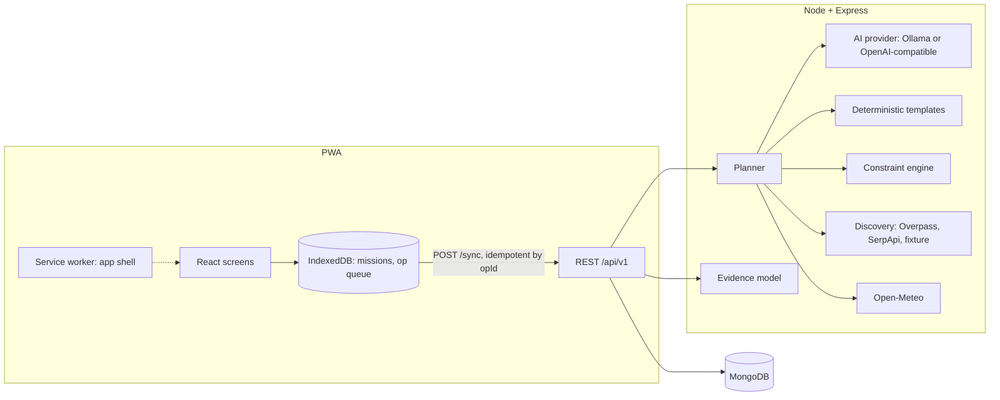

# ShadeLoop

**Go outside. Discover more. Make every walk count.**

ShadeLoop is an open-source outdoor field companion. It proposes short outdoor missions (5–120 min) that a deterministic rule engine has checked. You run them in an offline-capable Field Mode and record what you actually find. Those reports feed a shared, explainable evidence model that makes the next recommendations more honest.

## The problem

Map apps tell you a park exists. They can't tell you whether the bench is still there, whether the shade is real at 2 pm, or whether it's quiet. AI assistants will happily invent those facts. ShadeLoop treats every such condition as **unknown until people report it**, and shows where each claim comes from.

## Field truth loop

1. **Plan:** a request is parsed into constraints (AI or keyword fallback). Candidates come from AI or templates, then pass the constraint engine: time, walking limit, safety text, real locations only, and required conditions checked against evidence.
2. **Go:** Field Mode shows one step at a time with big quick-observation buttons (e.g. `shade_quality = none`). Everything is queued in IndexedDB and works offline.
3. **Report:** completing a mission produces planned-vs-observed comparisons (`observed_lower_than_expected`, …) and a summary (AI or template, always labelled).
4. **Learn:** each location report updates a categorical evidence summary per (location, attribute): `unknown | low | moderate | conflicting | stale`. Future plans show these and refuse places whose *required* conditions are contradicted.

## Architecture



The AI never writes to the database, decides safety, invents places or weather, or overrides the engine. See [docs/AI_POLICY.md](docs/AI_POLICY.md).

## Stack

npm workspaces: `shared` (Zod schemas), `server` (Node ≥ 23.6 running TypeScript natively, Express 5, Zod, MongoDB driver, pino, helmet, express-rate-limit), `web` (React 19, Vite 8, vite-plugin-pwa, idb). Tests: Vitest, Supertest, mongodb-memory-server, fake-indexeddb.

## Setup

Requires Node ≥ 23.6 (tested on 26.10).

```bash
npm install
cp .env.example .env          # defaults: in-memory MongoDB, AI off, live OSM discovery
npm run dev                   # API on :8080, web on :5173 (proxies /api)
```

The first run with `MONGODB_URI=memory` downloads a MongoDB binary (about 100 MB) through mongodb-memory-server.

**Gemma via Ollama (optional):** `ollama pull gemma3:4b`, run `ollama serve`, then set `AI_PROVIDER=ollama` in `.env`. Local planning with gemma3:4b took about 20–30 s per request on the development Mac.

**Production-style run:** `npm run build && MONGODB_URI=<atlas-uri> NODE_ENV=production npm start` serves the API and the built PWA on `:8080`.

## Environment variables

| Variable | Default | Purpose |
|---|---|---|
| `MONGODB_URI` | required | Atlas/Mongo URI, or `memory` (dev/test only; rejected in production) |
| `MONGODB_DB` | `shadeloop` | Database name |
| `PORT` / `NODE_ENV` / `LOG_LEVEL` | `8080` / `development` / `info` | |
| `TRUST_PROXY` | `0` | Proxy hops (Render: `1`) for rate-limit IPs |
| `RATE_LIMIT_PER_MIN` | `120` | Per-IP budget. Planning, discovery and note parsing get 1/8 of it, session creation 1/6 |
| `AI_PROVIDER` | `none` | `none`, `ollama` or `openai` |
| `OLLAMA_URL` / `OLLAMA_MODEL` | `http://localhost:11434` / `gemma3:4b` | |
| `OPENAI_BASE_URL` / `OPENAI_API_KEY` / `OPENAI_MODEL` | none | Any OpenAI-compatible chat-completions API |
| `AI_TIMEOUT_MS` / `AI_MAX_RETRIES` | `60000` / `1` | Per attempt, and extra attempts after the first |
| `DISCOVERY_MODE` | `live` | `live` (Overpass, plus SerpApi if a key is set) or `fixture` (labelled fake places) |
| `SERPAPI_KEY` | none | Enables SerpApi Google Maps results |
| `OVERPASS_URL` / `OPEN_METEO_URL` / `HTTP_TIMEOUT_MS` | public endpoints / `20000` | |

## Testing

```bash
npm run lint && npm run typecheck && npm test && npm run build
```

There are 49 server tests (unit and integration, including an end-to-end field-truth-loop test) and 6 web queue tests. External services are mocked in tests. See [docs/TEST_PLAN.md](docs/TEST_PLAN.md).

## Deployment

- **Render:** `render.yaml` defines one web service that serves the API and PWA. Set `MONGODB_URI` (Atlas) in the dashboard.
- **Docker:** `docker build -t shadeloop . && docker run -p 8080:8080 -e MONGODB_URI=... shadeloop`.
- **CI:** `.github/workflows/ci.yml` runs lint, typecheck, test and build.

## Demo

1. `npm run dev`, open http://localhost:5173.
2. Settings → "Use my approximate location" (rounded to about 1 km), then Save.
3. Discover → "a quiet 20 minute break with some shade" → Suggest missions. Each card shows whether AI or a template produced it, the evidence status of each condition, and what is unknown.
4. Open a mission → Start → record a few quick observations. Go offline (DevTools) and keep recording. The badge shows "Offline · N waiting to sync". Reload: the mission still opens. Go back online and the queue syncs.
5. End mission → see planned vs actual and the report. Run the same place with other sessions (e.g. private windows) to watch the evidence move from `low` to `moderate`, or to `conflicting`.

For a demo without network discovery, set `DISCOVERY_MODE=fixture`. Places are then labelled "sample fixture, not real" everywhere.

## Limitations (honest)

- No real auth: anonymous bearer-token sessions only. Clearing site data loses access to your missions.
- No routing. Distances are straight-line from a coarse (about 1 km) location, and travel time is an estimate.
- Evidence needs several independent sessions to reach `moderate`. Sessions are not identities, so one person with many sessions can skew it.
- Small local models (gemma3:4b) often overshoot time budgets. The engine shortens or rejects them, then falls back to templates. AI summaries can over-state; the comparison table is the deterministic source of truth.
- The public Overpass API is sometimes slow or returns 504. Planning then proceeds without named places and says so.
- English only. Voice uses browser APIs only (Web Speech), where supported.
- The repo lives at `~/ShadeLoop` (see docs/DECISIONS.md, item 0).

## License

MIT
