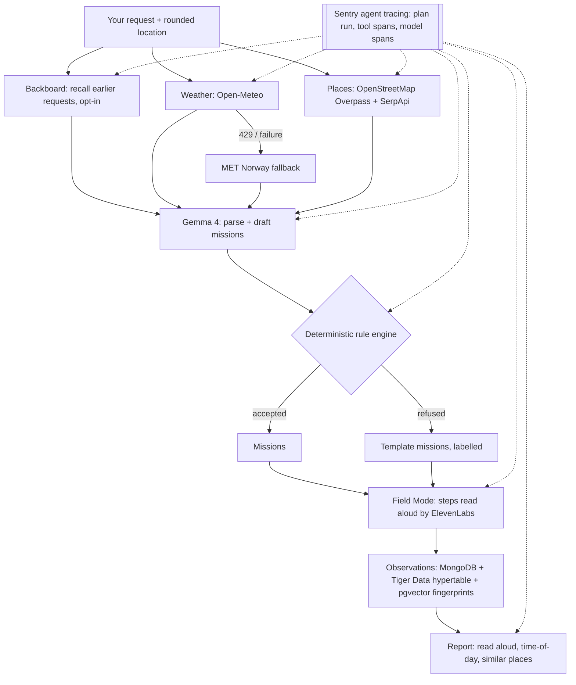

_This is a submission for the [DEV Hacktoberfest 2026 "Touch Grass" challenge](https://dev.to/challenges)._

## What I Built

**ShadeLoop** is a field journal that turns "I have 20 minutes" into a short, safe outdoor mission near you, and then turns what you notice outside into shared evidence for the next person.

You describe the outing you want ("a quiet 20 minute break somewhere shady with a bench"), and ShadeLoop:

1. **Reads your request** with an open-weight model (Gemma 4), and remembers your earlier requests only if you opt in (Backboard).
2. **Checks the real world**: current weather (Open-Meteo, with MET Norway as an automatic fallback) and mapped parks and gardens near your _rounded_ location (OpenStreetMap plus SerpApi).
3. **Drafts missions** with Gemma, then runs every draft through a **deterministic rule engine** that checks your time budget, walking limits, accessibility needs and past field reports. The engine has the final word: it can shorten or refuse a draft, and then template missions are used and labelled as such.
4. **Field Mode** walks you through each step, with read-aloud steps (ElevenLabs, or your browser's voice offline), quick observation taps (shade, noise, bench, crowding, path, step-free) and dictated notes that Gemma turns into suggested observations you confirm.
5. **Closes the loop**: you get a report you can listen to, and your observations become evidence: time-of-day patterns and "places with similar field reports" (Tiger Data, TimescaleDB plus pgvector).

It's an installable PWA that works offline (an IndexedDB queue that syncs idempotently), and every plan shows a **process log**: what ran, how long it took, what failed and what covered for it. Nothing is presented as more certain than it is.

## Demo

**Live app:** https://shadeloop.onrender.com (free Render instance, so the first load can take ~30–60 s to wake up)



## Code

Repo: [github.com/CodewithJha/shadeloop](https://github.com/CodewithJha/shadeloop) (MIT)



## How I Built It

**Stack:** npm workspaces (`shared`, `server`, `web`) · React 19 + Vite 8 PWA (vite-plugin-pwa, IndexedDB offline queue) · Express 5 + Zod · MongoDB Atlas · Tiger Data (TimescaleDB hypertable + 15-min continuous aggregate, pgvector) · Gemma 4 `gemma-4-26b-a4b-it` via Google AI Studio (or `gemma3:4b` locally via Ollama) · Backboard · ElevenLabs · SerpApi · OpenStreetMap Overpass (with mirror failover) · Open-Meteo → MET Norway · Sentry agent tracing · Docker on Render · Vitest (with mongodb-memory-server) · GitHub Actions CI.

**Real numbers from today's live runs on https://shadeloop.onrender.com (12 Oct 2026, a throwaway session in Bengaluru, deleted afterwards via `DELETE /me`):**

- **Process log of a full plan (28.1 s total):** Gemma read the request in 10.6 s → Backboard recall 63 ms → places 3.5 s (OpenStreetMap: 45 places, SerpApi: **20 places**) → Gemma drafted 2 candidates in 11.7 s → rule engine accepted both → Backboard save 1.9 s.
- **Second plan:** Backboard **recalled 1** earlier request.
- **Rule engine refusal** (in an earlier live run today): Gemma proposed a walk of **23 min against a 20 min limit**, the engine refused it ("walking 23 min exceeds your limit of 20 min") and fell back to labelled templates.
- **Weather:** Open-Meteo returned **HTTP 429** from Render's shared IP; the process log read `Open-Meteo failed (Open-Meteo HTTP 429) → MET Norway: 28.5°C` (1.3 s).
- **ElevenLabs:** step audio 17.6 KB in 1.5 s; report audio 61 KB in 1.6 s.
- **Tiger Data pgvector:** two parks with different field reports matched at **similarity 0.4** (not a fake 1.0), and time-of-day patterns were read back from the hypertable.
- **Offline replay idempotency:** sending the same observation twice returned **201 then 200** and stored it once.
- **Delete my data:** removed missions, observations, reports, Tiger rows and the Backboard memory; the old token then got 401.
- **Tests:** **129 server** and **43 web** tests (Vitest), plus lint, typecheck, PWA build and Docker build in CI.

## Why Does Open Innovation Matter?

Getting someone outside for 20 minutes sounds small, but the tool that does it knows where you are, when you're free and what you struggle with. That's exactly the kind of software that should be open.

- **Open weights.** The planner is Gemma, an open-weight model. Anyone can inspect what it is, run the same model, and reproduce the behaviour. There's no black box between you and the suggestion to walk somewhere.
- **Runs locally.** Set `AI_PROVIDER=ollama` and `gemma3:4b` runs on your own laptop (about 20–30 s per plan on my Mac). Your request never has to leave your machine, and the app still works with no AI at all: it falls back to labelled templates.
- **The model is not the authority.** A deterministic, tested rule engine checks every draft against your time, walking limit and accessibility needs. Open code means anyone can read the exact rules that keep a suggestion safe.
- **A transparent process log.** Every plan shows each step, its timing, what failed and what covered for it ("Open-Meteo 429 → MET Norway"). The integrations panel only says "verified" after a real call succeeded; a key that's merely set says "waiting for first use".
- **Open data, given back.** Places come from OpenStreetMap (credited on every mission), weather from Open-Meteo and MET Norway. Your field reports become evidence that helps the next person find shade or a free bench.
- **Privacy by design.** Location is rounded to about 1 km before it leaves your device, memory is opt-in, there are no accounts (just an anonymous session), and **Delete my data** wipes MongoDB, Tiger Data and Backboard in one call.
- **MIT licence.** Fork it for your campus, your city or your accessibility needs.

## My Agent Session

- **Entire session:** https://entire.io/gh/CodewithJha/shadeloop/commit/89b8eada487181a88134341db161312060d1bce4
- **GitHub Copilot CLI** picked up [issue #1](https://github.com/CodewithJha/shadeloop/issues/1) and fixed it in commit `89b8ead`, which is the session linked above.

## Prize Categories

- **Gemma:** Gemma 4 (`gemma-4-26b-a4b-it`) parses requests and field notes and drafts missions live; `gemma3:4b` runs locally via Ollama; a deterministic engine checks every draft.
- **Sentry Agent Tracing:** each plan is traced as an agent run, with tool spans (recall_memory, get_weather, discover_places, propose_missions, speak_step/speak_report) and model spans.
- **MongoDB Atlas:** stores missions, observations, reports, shared place evidence and the idempotent offline sync records.
- **ElevenLabs:** reads Field Mode steps and the completion report aloud (live: 17.6 KB step audio in 1.5 s).
- **Backboard:** opt-in memory of your own earlier requests, recalled on the next plan (live: recalled 1), and deleted with your data.
- **Tiger Data:** TimescaleDB hypertable + continuous aggregate for "reports here by time of day", and pgvector cosine search for "places with similar field reports" (live similarity 0.4).
- **SerpApi:** Google Maps place results alongside OpenStreetMap (live: 20 places), covering OSM when it fails from Render.
- **GitHub Copilot:** Copilot CLI fixed issue #1 (commit `89b8ead`); CI runs lint, typecheck, 129 + 43 tests, the PWA build and a Docker build on every push.
- **Render:** the whole app (API + PWA) runs as one Docker web service on Render's free tier.
- **Entire:** the agent session behind the Copilot fix is published on Entire (link above).

## Sentry

_A single ShadeLoop plan traced in Sentry as an agent run: memory recall, weather (with the MET Norway fallback), place discovery, Gemma drafting and rule-engine checks as spans._

## Bonus: Taking it outside

<!-- Fill this in with your own experience. Do not publish it with placeholder text. -->

- **Where I went:** [place, city]
- **The mission ShadeLoop gave me:** [mission title, minutes]
- **What I noticed and logged:** [shade / noise / bench / crowding …]
- **How it felt / what surprised me:** [your words]
- **Photo (optional):** 

## Limitations and honesty

- **Cold start:** the free Render instance sleeps when idle, so the first request can take 30–60 s.
- **Weather:** Open-Meteo rate-limits Render's shared IP (HTTP 429). MET Norway now covers it automatically, but MET Norway has no "feels like" temperature, so heat and cold notes based on it don't appear on those plans.
- **Places:** public OpenStreetMap Overpass sometimes fails from Render (its mirrors too); SerpApi still supplies places and the panel marks OSM "covered by SerpApi".
- **Sentry:** traces are sent, but the app can't confirm delivery itself, and says so.
- **Evidence is young:** field-report patterns and similarity need real reports to be meaningful; with few reports the app says "insufficient data" rather than guessing.
- Search results show that a place is mapped, not that it is shaded, safe, accessible or open.
